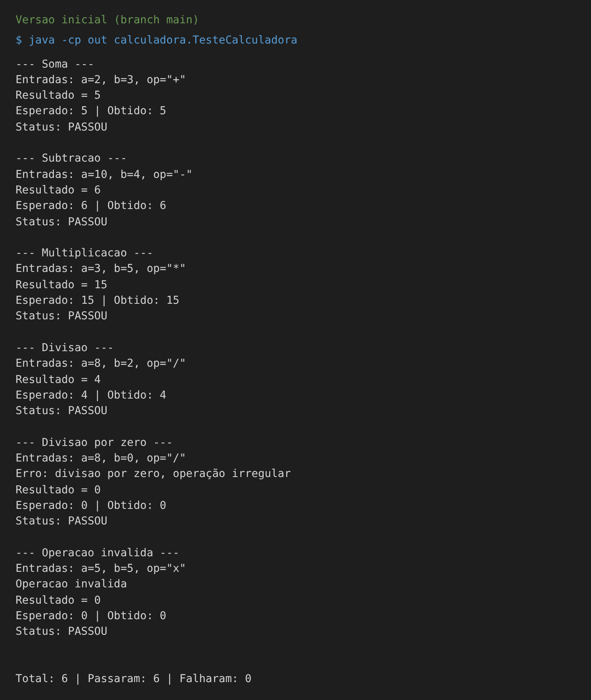

# Projeto Calculadora — FinançApp

> Projeto acadêmico desenvolvido com foco em Qualidade de Software, Testes, Refatoração, Documentação e Versionamento.

---

## 1. Identificação do Projeto

**Projeto:** Projeto Calculadora  
**Contexto:** FinançApp  
**Aluno:** Mateus Coelho Cardoso  
**RA:** 250855  
**Curso:** Análise e Desenvolvimento de Sistemas (Facens)  
**Disciplina:** UX/UI e Testes de Software (turma AS406TSN2)  
**Professor:** Daniel Ohata  
**Semestre:** 2026.2  

---

# 2. Visão Geral

O projeto consiste no desenvolvimento de um módulo de cálculos matemáticos básicos em Java para a startup fictícia **FinançApp**.

O módulo foi desenvolvido com o objetivo de ser utilizado futuramente em funcionalidades de controle financeiro, como:

- orçamento mensal;
- divisão de despesas;
- projeções financeiras;
- cálculos auxiliares.

Além do funcionamento correto das operações, o projeto aplica práticas de qualidade de software relacionadas a:

- testes;
- tratamento de erros;
- refatoração;
- documentação;
- versionamento;
- manutenção de código.

---

# 3. Problema

Durante o desenvolvimento da aplicação FinançApp, foi identificada a necessidade de criar um módulo matemático reutilizável.

Entretanto, a equipe definiu que o módulo não deveria apenas funcionar corretamente, mas também apresentar:

- código legível;
- testes automatizados;
- tratamento de falhas;
- documentação técnica;
- controle de versões;
- facilidade de manutenção.

O desafio consiste, portanto, em desenvolver uma solução funcional e ao mesmo tempo aplicar boas práticas de Engenharia de Software.

---

# 4. Objetivo

## 4.1 Objetivo Geral

Desenvolver uma calculadora em Java aplicando práticas de qualidade, testes, documentação, refatoração e versionamento.

## 4.2 Objetivos Técnicos

- implementar operações matemáticas básicas;
- tratar entradas inválidas;
- impedir divisão por zero;
- desenvolver testes automatizados;
- refatorar o código sem alterar seu comportamento;
- documentar classes e métodos com JavaDoc;
- gerar documentação HTML;
- utilizar Git e GitHub;
- organizar commits e branches;
- manter documentação técnica no README.

---

# 5. Escopo Funcional

A aplicação deverá oferecer as seguintes operações:

| ID | Funcionalidade | Descrição | Status |
|---|---|---|---|
| RF01 | Soma | Soma dois números inteiros | ✅ |
| RF02 | Subtração | Subtrai dois números inteiros | ✅ |
| RF03 | Multiplicação | Multiplica dois números inteiros | ✅ |
| RF04 | Divisão | Divide dois números inteiros | ✅ |
| RF05 | Validação de divisão | Impede divisão por zero | ✅ |
| RF06 | Operação inválida | Trata operadores não suportados | ✅ |

---

# 6. Requisitos Não Funcionais

| ID | Categoria | Requisito |
|---|---|---|
| RNF01 | Qualidade | O código deve possuir organização e legibilidade |
| RNF02 | Testabilidade | As operações devem possuir testes automatizados |
| RNF03 | Manutenção | O código deve permitir refatoração sem alteração funcional |
| RNF04 | Documentação | Classes e métodos devem possuir JavaDoc |
| RNF05 | Versionamento | O projeto deve utilizar Git e GitHub |
| RNF06 | Confiabilidade | Erros não devem interromper inesperadamente a execução |

---

# 7. Tecnologias Utilizadas

| Tecnologia | Versão | Utilização |
|---|---|---|
| Java | 21 | Desenvolvimento |
| JDK | 21 | Compilação |
| Testes | — | Classe TesteCalculadora (método main) |
| Git | 2.43 | Controle de versão |
| GitHub | — | Repositório remoto |
| JavaDoc | — | Documentação |
| IDE | Eclipse | Ambiente de desenvolvimento |

---

# 8. Estrutura do Projeto

```text
projeto_calculadora/
│
├── src/
│   └── calculadora/
│       └── Calculadora.java
│
├── test/
│   └── calculadora/
│       └── TesteCalculadora.java
│
├── docs/
│   └── index.html
│
├── images/
│   ├── testes/
│   ├── javadoc/
│   └── refatoracao/
│
├── README.md
├── .gitignore
└── demais arquivos do projeto
```

---

# 9. Explicação das Operações

Esta é a **versão inicial** do projeto (branch `main`). A versão refatorada e documentada está na branch `Refatoracao`.

A classe `Calculadora` (pacote `calculadora`) possui o método principal:

```java
public int calc(int a, int b, String op)
```

Ele recebe dois números inteiros e um operador e retorna o resultado como `int`. O resultado fica guardado no atributo `r`.

| Operador | Operação | Exemplo | Resultado |
|---|---|---|---|
| `+` | Soma | `calc(2, 3, "+")` | 5 |
| `-` | Subtração | `calc(10, 4, "-")` | 6 |
| `*` | Multiplicação | `calc(3, 5, "*")` | 15 |
| `/` | Divisão | `calc(8, 2, "/")` | 4 |

Tratamento de erros: divisão por zero e operador inválido mostram uma mensagem no console e retornam 0, sem derrubar o programa.

---

# 10. Testes

A classe `TesteCalculadora` testa soma, subtração, multiplicação, divisão, divisão por zero e operação inválida, mostrando as entradas, o resultado esperado e o resultado obtido.

```bash
javac -encoding UTF-8 -d out src/calculadora/*.java test/calculadora/*.java
java -cp out calculadora.TesteCalculadora
```



---

# 11. Refatoração e Documentação

A refatoração, os testes atualizados, o JavaDoc e a documentação HTML (`docs/index.html`) estão na branch `Refatoracao`.

---

# 12. Link do Repositório

https://github.com/mateuscoelho07-debug/Atividade-Ohata
